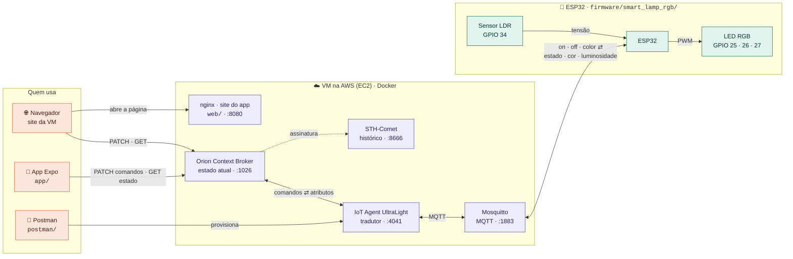
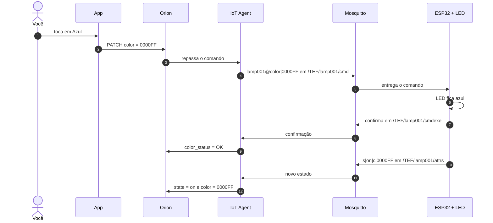
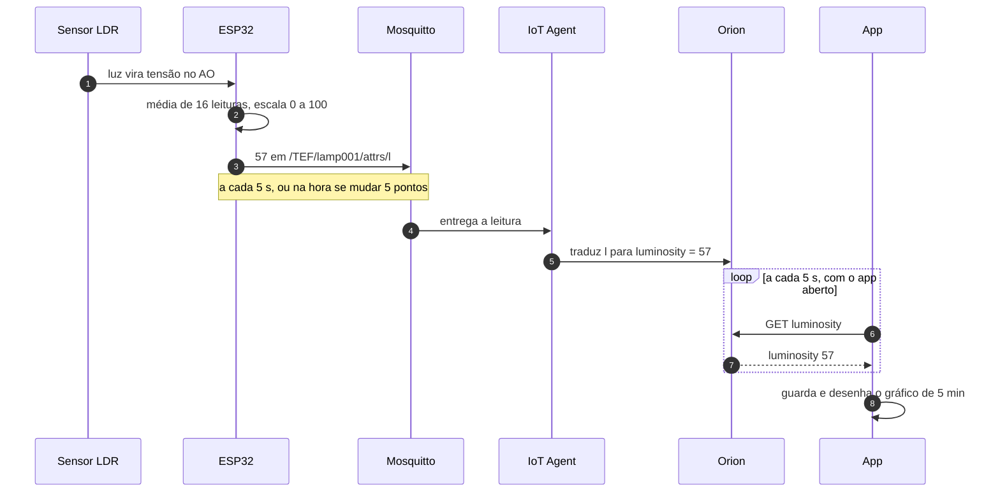

# Smart Lamp RGB: app + firmware

Extensão do [FIWARE Made Simple](https://github.com/fabiocabrini/fiware-made-simple) para controlar a cor de um LED RGB pelo celular, com roda de cores, botões de cor fixa, comando de voz e acompanhamento da luminosidade do ambiente (sensor LDR).

## Arquitetura

O projeto tem três partes: **quem usa** (app, navegador, Postman), a **VM na AWS** com o FIWARE em Docker e o **ESP32** com o LED e o sensor. O celular nunca fala direto com o ESP32: os dois só se encontram no servidor. É o ESP32 quem abre a conexão com o Mosquitto, por isso ele funciona atrás do Wi-Fi de casa ou da faculdade.



> **Sem VM e sem ESP32?** O `simulador/` faz o papel da caixa roxa (Orion + site) e da verde (ESP32 + LED + LDR) no seu PC. Veja a seção 6.

### Fluxo do comando: da tela até o LED

O app só fala com o Orion, com o mesmo `PATCH` da pasta 4 da collection. O IoT Agent transforma o comando em uma mensagem MQTT, e o ESP32 confirma em `/cmdexe`. Sem essa confirmação, o `color_status` fica `PENDING` para sempre.



### Fluxo da luminosidade: do LDR até o gráfico

Aqui o caminho é o inverso: o ESP32 **envia** a leitura sozinho, e o app **vai buscar** no Orion. O Orion guarda só o valor atual; o histórico de 5 minutos do gráfico é montado pelo próprio app. O histórico longo fica no STH-Comet, se a assinatura 2.6 da collection do professor estiver criada.



## Pastas

| Pasta | O que é |
|---|---|
| `firmware/smart_lamp_rgb/` | Sketch do ESP32 com LED RGB e o comando `color` |
| `postman/` | Requisições para reprovisionar o `lamp001` com `color` e testar |
| `app/` | Projeto do app Expo (React Native): tela em `App.tsx`, componentes em `src/components/` |
| `scripts/` | `iniciar.cmd` abre o app em qualquer PC Windows; `simular.cmd` testa sem VM nem ESP32; `gerar-web.cmd` recria a versão web |
| `simulador/` | Imita a VM (Orion + site) e o ESP32 no próprio PC, com uma lâmpada virtual (seção 6) |
| `web/` | Versão web pronta (`site/`) + nginx em Docker para rodar na VM (seção 5) |

## 1. Contrato novo

| | Antes | Agora |
|---|---|---|
| Comandos | `on`, `off` | `on`, `off`, `color` (valor `RRGGBB`) |
| Atributos | `s` → `state`, `l` → `luminosity` | + `c` → `color` |
| MQTT do comando | `lamp001@on\|` | `lamp001@color\|0000FF` |

Exemplo de troca de cor (o que o app envia):

```http
PATCH http://<IP>:1026/v2/entities/urn:ngsi-ld:Lamp:001/attrs
fiware-service: smart
fiware-servicepath: /
Content-Type: application/json

{ "color": { "type": "command", "value": "0000FF" } }
```

## 2. Reprovisionar o device (uma vez)

O IoT Agent só repassa comandos que foram declarados no provisionamento. Importe `postman/Smart Lamp RGB.postman_collection.json`, ajuste a variável `url` para o IP da VM e rode **R.1 → R.2 → R.3**. Depois teste com **R.4** e confira com **R.5** (`color_status` deve ficar `OK`).

## 3. Firmware

1. Ligue o LED RGB: R → GPIO 25, G → GPIO 26, B → GPIO 27, cada um com um resistor de 220 Ω a 330 Ω. A perna comum vai no GND (cátodo comum) ou no 3V3 (ânodo comum).
2. Em `smart_lamp_rgb.ino`, preencha o Wi-Fi e o IP da VM. Se o LED for de ânodo comum, ponha `COMMON_ANODE = true`. Sinal de ânodo comum configurado errado: as cores saem invertidas (azul vira amarelo).
3. Ligue o **módulo LDR** (sensor de luminosidade): `VCC` → 3V3, `GND` → GND, `AO` → GPIO 34.
4. Grave pela Arduino IDE (placa *DOIT ESP32 DEVKIT V1*, biblioteca *PubSubClient*). Ao ligar, o LED pisca vermelho, verde e azul.

**Luminosidade (LDR):** o firmware lê o sensor 4 vezes por segundo, faz a média de 16 leituras para não oscilar e publica de 0 (escuro) a 100 (muito claro) no atributo `luminosity` a cada 5 s, ou na hora se mudar 5 pontos ou mais. Para conferir no Monitor Serial (115200), tampe o sensor com o dedo: o valor tem que **cair**. Se subir, mude `LDR_INVERT` para `true` (alguns módulos dão valores maiores no escuro).

## 4. App

No celular, instale o **Expo Go** (Play Store / App Store, versão mais recente).

> **Versão do Node:** o Expo SDK 58 exige **Node 22.13+, 24.3+ ou 26+**. Com Node 20 o `npm install` ou o Metro falham.

### Jeito fácil (qualquer PC Windows, inclusive o da faculdade)

Dê dois cliques em **`scripts/iniciar.cmd`**. Ele:

1. usa o Node do PC se for compatível; senão baixa o Node LTS **portátil** do nodejs.org para `%LOCALAPPDATA%\smart-lamp-node` (sem administrador, confere o SHA-256 e não altera o sistema);
2. roda `npm install` na primeira vez;
3. abre o Expo em **modo túnel** (ngrok), que funciona mesmo no Wi-Fi da faculdade e no 4G, sem conta Expo.

Leia o QR code (Android: pelo Expo Go; iPhone: pela câmera). Para abrir no navegador em vez do celular: `scripts\iniciar.cmd -Modo web`.

### Jeito manual (Node compatível já instalado)

```bash
cd app
```

```bash
npm install
```

```bash
npm run tunnel
```

| Comando | Quando usar |
|---|---|
| `npm run tunnel` | Recomendado: funciona em qualquer rede (usa ngrok, não precisa de conta) |
| `npm start` | Celular e PC na mesma rede Wi-Fi, sem bloqueio entre aparelhos |
| `npm run web` | Testar no navegador do PC (o Orion do professor já libera CORS) |

Para levar a outro computador: clone o repositório do GitHub (ou copie a pasta **sem** `node_modules`) e use o `iniciar.cmd`.

Em todos os casos quem precisa alcançar a VM é o **celular** (ou o navegador), não o PC: a porta 1026 tem que estar liberada no Security Group da AWS para a rede de onde vocês estão testando.

Na primeira vez o app abre a tela de configurações: informe o **IP público da VM**, toque em **Testar conexão** e salve.

Testado com Expo SDK 58, React Native 0.88, Reanimated 4.7 e reanimated-color-picker 5.1 (TypeScript sem erros; tela, roda de cores, botões e requisições conferidos no navegador contra um Orion simulado; `iniciar.cmd` testado sem Node no PATH e túnel ngrok respondendo pela internet).

### O que tem na tela

- **Lâmpada central**: halo na cor atual que "respira" quando ligada; tocar liga/desliga. O brilho de fundo da tela acompanha a cor.
- **Indicadores**: estado, cor e conexão com o horário da última sincronização ("agora", "há 20s"…).
- **Cor da luz**: abas **Roda** (roda de cores + brilho; a cor é enviada quando você solta o dedo) e **Paleta** (primárias, secundárias e branco), mais as **Recentes** (últimas 6, salvas no celular).
- **Luminosidade** do ambiente medida pelo LDR: valor atual (escuro, penumbra, claro, muito claro), gráfico dos últimos 5 minutos (toque ou passe o mouse para ver cada ponto), mínima, média e máxima, e uma visão em tabela. O app consulta o Orion a cada 5 s enquanto está aberto.
- **Comando de voz** com animação enquanto escuta (só no app; na versão web não aparece).
- Vibração leve ao tocar.

**Design:** feito com a skill *UI/UX Pro Max* (estilo glassmorphism, paleta slate escura, fonte Plus Jakarta Sans). Os tokens (cores, espaçamentos, tipografia, tempos de animação) ficam em `app/src/theme.ts`. Alvos de toque têm no mínimo 44–48 pt, o contraste dos textos passa de 4,5:1 e as animações são desligadas quando o celular está com "reduzir movimento" ativo.

### Comando de voz

O reconhecimento de voz usa código nativo, que **não existe no Expo Go**. No Expo Go o app funciona inteiro, mas o botão de microfone fica apagado. Para ter a voz, gere uma *development build*:

- **Android com cabo USB e Android Studio instalado:** `npx expo run:android`
- **Sem Android Studio:** `npx eas-cli build -p android --profile development` gera um APK na nuvem (conta Expo gratuita).
- **iPhone:** `npx expo run:ios` em um Mac, ou EAS com conta de desenvolvedor Apple.

Segure o botão, fale e solte. Frases que funcionam: "azul", "deixa vermelho", "luz verde", "azul claro", "rosa", "laranja", "roxo", "branco", "liga", "desliga", "apaga". O vocabulário fica em `src/colors.ts`. No Android, o reconhecimento precisa do app Google instalado.

## 5. Versão web na VM (plano B, sem PC e sem instalar nada)

O app também roda como site, servido pela própria VM da AWS. Qualquer celular (Android ou iPhone) abre `http://IP-DA-VM:8080` no navegador e controla a lâmpada. O IP do Orion já vem preenchido, porque é o mesmo da página.

Nessa versão **não há comando de voz**: o navegador só libera o microfone em HTTPS, e a VM serve HTTP. Roda de cores, cores rápidas, recentes e liga/desliga funcionam normalmente.

O site já vem pronto em `web/site`. Na VM não precisa de Node, só do Docker que o FIWARE já usa.

**Uma vez só:**

1. No **Security Group** da VM, libere a porta **8080 (TCP)**, do mesmo jeito que a 1026.
2. Entre na VM por SSH e baixe o repositório. Como ele é privado, o Git pede usuário e um **token** do GitHub no lugar da senha (crie em *GitHub → Settings → Developer settings → Personal access tokens → Fine-grained*, com acesso de leitura a este repositório):
   ```bash
   git clone https://github.com/raphaelriquetto/smart-lamp-rgb.git
   ```
3. Suba o site:
   ```bash
   cd smart-lamp-rgb/web
   ```
   ```bash
   docker compose up -d
   ```
4. No celular, abra `http://IP-DA-VM:8080`. Dica: no menu do navegador, use **Adicionar à tela inicial** para abrir como um app, em tela cheia.

**Sem querer usar token:** copie só a pasta `web` do seu PC para a VM com a mesma chave `.pem` que vocês usam no SSH (`ubuntu` no Ubuntu, `ec2-user` no Amazon Linux) e rode o passo 3 dentro dela:
```bash
scp -i chave.pem -r web ubuntu@IP-DA-VM:~/smart-lamp-web
```

**Quando mudar o app:** no PC, rode `scripts\gerar-web.cmd` (recria `web/site`), faça commit e push, e na VM rode `git pull` dentro de `smart-lamp-rgb`. Não precisa reiniciar o container: o nginx já serve os arquivos novos.

**Parar o site:** `docker compose down` dentro de `web`.

## 6. Testar sem a VM e sem o ESP32 (simulador)

Para ver o app funcionando sem AWS e sem hardware, dê dois cliques em **`scripts/simular.cmd`**. Ele só precisa do Node (baixa o portátil se faltar) e abre duas páginas no navegador:

| Endereço | O que é |
|---|---|
| `http://localhost:8080` | O app, igual ao site da VM |
| `http://localhost:1026` | A **lâmpada virtual**: um LED na tela que acende na cor enviada, um controle para simular a luz do ambiente no **sensor LDR** e a lista de comandos recebidos |

O simulador responde como o Orion de verdade nas requisições que o app e a collection usam: o comando fica `PENDING` por um instante e vira `OK` quando o "ESP32" confirma, e comandos ou entidades errados recebem os mesmos erros 422 e 404. Dá até para apontar a collection do Postman para `localhost`.

**No celular:** com o celular no mesmo Wi-Fi do PC, abra o endereço `http://IP-DO-PC:8080` que o simulador mostra no terminal. Na primeira vez o Windows pergunta se o Node pode receber conexões na rede: permita em **redes privadas**.

O que o simulador **não** testa: o ESP32 de verdade, o MQTT e as portas da AWS. Para isso, use a VM (seção 5).

## 7. Problemas comuns

| Sintoma | Causa provável |
|---|---|
| `npm install` falha com `EBADENGINE` ou o Metro não inicia | Node antigo (ex.: 20.x). Use o `scripts/iniciar.cmd` |
| "Couldn't create a signed tunnel URL… not logged in" | Use `npm run tunnel` (ngrok) em vez de `npx expo start --tunnel` |
| Expo Go diz que o projeto usa um SDK incompatível | Atualize o Expo Go na loja |
| Site da VM não abre (`http://IP:8080`) | Porta 8080 fechada no Security Group, ou container parado (`docker compose ps` dentro de `web`) |
| Site abre mas mostra "Sem conexão" | Porta 1026 fechada para a rede do celular: o navegador do celular chama o Orion direto |
| "Tempo esgotado" no app | Porta 1026 fechada no Security Group da AWS, IP errado, ou VM desligada (o IP público muda quando a VM reinicia, a não ser que você use um Elastic IP) |
| `color_status` fica `PENDING` | O ESP32 não está conectado ao broker ou ainda está com o firmware antigo |
| Orion responde 422/400 em `color` | O device não foi reprovisionado com o comando `color` (passo 2) |
| Cores trocadas | `COMMON_ANODE` errado ou pinos R/G/B trocados |
| App funciona no Expo Go mas não no APK final | Faltou o plugin `expo-build-properties` com `usesCleartextTraffic` (o Orion usa HTTP sem TLS) |

> **Segurança:** o Orion não tem autenticação. Qualquer pessoa que saiba o IP pode trocar a cor da lâmpada. Para o projeto basta liberar a porta 1026 só para os IPs que vocês usam (veja `docs/07-security.md` do repositório do professor).
